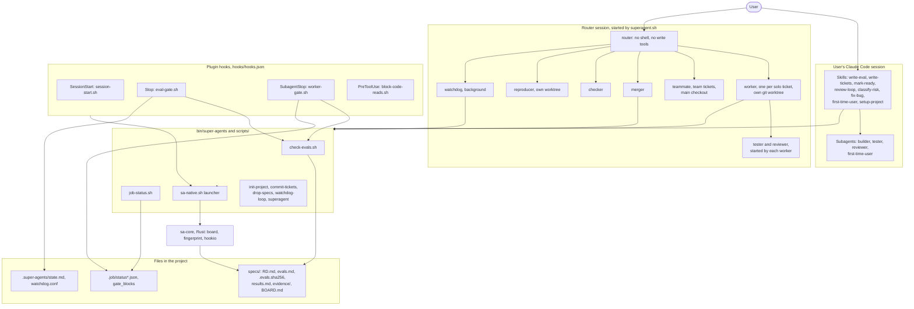
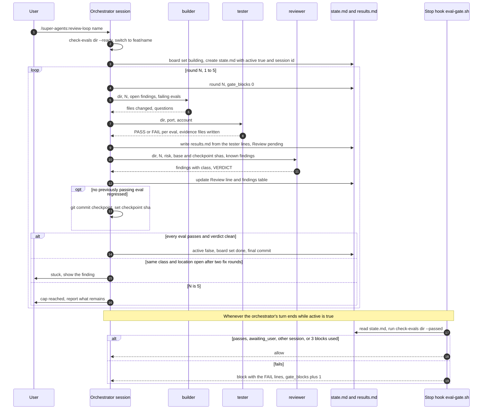
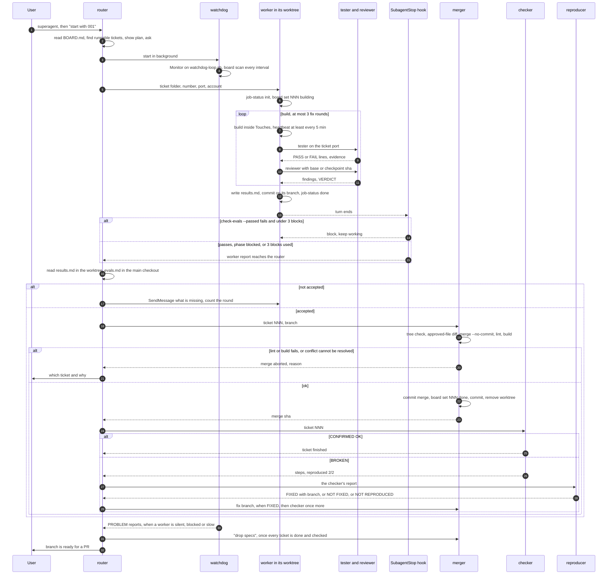
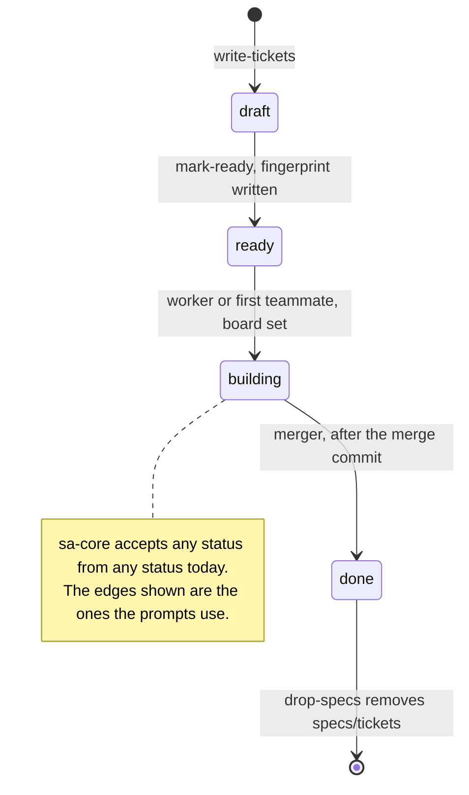

# super-agents architecture

Written 2026-11-13 against branch `docs/architecture-and-design-issues` (plugin version 0.3.1 in
`.claude-plugin/plugin.json:4`). Every statement cites the file it was read from. Paths are relative
to the repository root.

Related documents, which this one does not repeat:

- `docs/design/2026-11-11-design-review.md`: what is wrong with the current design (P1 to P9).
- `docs/design/2026-11-11-design-changes.md`: the target design and the v0.4.1 / v0.5.0 / v0.6.0
  roadmap, with live-test evidence under `docs/design/evidence/`.
- `docs/design/2026-11-13-design-issues-and-fixes.md`: the issue register (carried-over and new).

This document describes the system **as it is in the code today**, not the target design.

## 1. What the system is

A Claude Code plugin (`.claude-plugin/plugin.json`) made of prompts (skills and agents), four hooks,
a dozen bash scripts and a small Rust helper, `sa-core`. Its purpose is stated in `README.md:3-6`:
agents must prove work against evals the user approved before they may call it done, and many
features can be built in parallel while the user talks to one agent.

There are two flows. Both start from a written spec (`RD.md` plus `evals.md`) that the user approves.

### 1.1 Single feature, in the user's session

1. `/super-agents:write-eval <name>` writes `specs/<name>/RD.md`, `evals.md` and, for UI features,
   `mockup.html`. Status stays `draft` and nothing is built (`skills/write-eval/SKILL.md:12-22`).
2. The user approves. `super-agents board set <dir> ready` sets the `**Status:**` line and writes
   `.evals.sha256`, the fingerprint of `evals.md` (`core/src/board.rs:259-278`).
3. `/super-agents:review-loop <name>` makes the session an orchestrator. Per round it starts a
   `builder`, then a `tester`, then a `reviewer` subagent, for at most 5 rounds
   (`skills/review-loop/SKILL.md:39-58`). All of them work in the user's checkout on `feat/<name>`.

### 1.2 Many features, in parallel

1. `/super-agents:write-tickets <request>` writes `specs/tickets/NNN-slug/{RD.md,evals.md}` and
   `specs/tickets/BOARD.md` (`skills/write-tickets/SKILL.md:15-28`).
2. `/super-agents:mark-ready 001 002` validates and approves (`skills/mark-ready/SKILL.md:11-13`).
3. The user runs `superagent` in a terminal. `scripts/superagent.sh` offers an
   `integration/<timestamp>` branch when on main (`:8-13`), commits the tickets and project files
   (`:17`, `scripts/commit-tickets.sh`), and starts `claude --agent super-agents:router` in
   `--permission-mode auto` with agent teams enabled for that process (`:21-22`).
4. The router dispatches one `worker` per solo ticket (each in its own git worktree) or a team of
   `teammate` agents per team ticket, plus one background `watchdog` (`agents/router.md:39-43`).
5. Each worker builds, has its own `tester` and `reviewer` check the work, writes `results.md` and
   `evidence/`, and commits on its branch (`agents/worker.md:15-33`).
6. The router accepts or sends it back (`agents/router.md:46-47`), then runs `merger`, then
   `checker`, then `reproducer` if the checker found a break (`agents/router.md:48-49`).
7. When every ticket is done and checked, the merger runs `super-agents drop-specs`, which commits
   the removal of `specs/tickets/` (`agents/router.md:51`, `scripts/drop-specs.sh:13-25`).

## 2. Component map

### 2.1 Plugin manifest and loading

| File | Role |
|---|---|
| `.claude-plugin/plugin.json` | Name `super-agents`, version (the launcher reads it, `scripts/sa-native.sh:21`). |
| `.claude-plugin/marketplace.json` | A one-plugin marketplace with `source: "./"`, so the repo is its own marketplace. |
| `hooks/hooks.json` | The four hook registrations. Commands are `"${CLAUDE_PLUGIN_ROOT}"/scripts/<name>.sh`. |
| `agents/*.md`, `skills/*/SKILL.md` | Loaded by Claude Code under the `super-agents:` namespace. |
| `bin/super-agents` | One dispatcher for every script. Claude Code puts the plugin's `bin/` on the Bash tool's PATH (`bin/super-agents:3`); prompts call only `super-agents <command>`, never a script path (enforced by `tests/run.sh:469-472`). |

The versions in `plugin.json`, `marketplace.json` and `core/Cargo.toml` must be equal
(`tests/run.sh:484-487`).

**Project-local copies.** `.claude/agents/` and `.claude/skills/` hold byte-identical copies of the
plugin's 11 agents and 8 skills, added in commit `aab1bdc`, plus `.claude/agents/general-purpose.md`,
which overrides the built-in general-purpose agent with `model: claude-fable-5-2`. They are **not**
part of the plugin: they only take effect in sessions opened in this repository, where they appear a
second time without the `super-agents:` prefix. Nothing tests that they stay in sync. See issue N-04.

### 2.2 Skills

| Skill | Model may invoke it | `allowed-tools` | What it does and writes |
|---|---|---|---|
| `setup-project` | no (`:5`) | `Bash(super-agents *)` | Runs `super-agents setup`; tailors `review.md` `TODO` lines. |
| `classify-risk` | yes | none | One-line `RISK:` reply; sets `**Risk:**` in `RD.md` if it exists (`:15`). |
| `write-eval` | yes | `Bash(super-agents *)` | `RD.md`, `evals.md`, `mockup.html`; validates; stops at `draft`; on explicit approval runs `board set <dir> ready` (`:22`). |
| `write-tickets` | yes | `Bash(super-agents *)` | One ticket folder per feature via write-eval steps 1-5; `BOARD.md`; `board check`. |
| `mark-ready` | no (`:5`) | `Bash(super-agents *)` | `check-evals`, then `board set <NNN or dir> ready`, then `board check`. |
| `review-loop` | no (`:5`) | `Bash(super-agents *)` | Orchestrates builder, tester, reviewer; writes `.super-agents/state.md` and `<dir>/results.md`; checkpoint commits. |
| `first-time-user` | no (`:5`) | none | Starts the app on a throwaway sandbox and briefs the blind `first-time-user` agent. |
| `fix-bug` | yes | none | Reproduce, confirm cause, fix at the root, regression test; commit on `fix/<slug>`. |

"no" means `disable-model-invocation: true` in the frontmatter at the cited line of the skill's
`SKILL.md`. Skills must stay harness-neutral: name equals folder, description under 1,024 characters,
no `CLAUDE_PLUGIN_ROOT` (`tests/run.sh:461-465`).

### 2.3 Agents

All frontmatter is at the top of `agents/<name>.md`. "Isolation" is the `isolation:` key.

| Agent | Model, effort | Tools | Isolation | Started by | May write |
|---|---|---|---|---|---|
| `router` | opus, high | Read, Grep, Glob, Agent(8 named types), SendMessage, TaskStop, AskUserQuestion | none; it is the main thread | `scripts/superagent.sh:22` | Nothing: it has no write or shell tool (`router.md:4`). |
| `worker` | sonnet, high; maxTurns 200 | Read, Grep, Glob, Bash, Edit, Write, Agent, Monitor, TodoWrite | `worktree` | router, one per solo ticket, unnamed (`router.md:42`) | Source in its worktree; `TICKET_DIR/results.md`, `evidence/`; `.job/`; commits on its branch. Through `board set` it also changes `BOARD.md` and `RD.md` in the **main checkout** (`worker.md:15`). |
| `teammate` | sonnet, high | same as worker | none; main checkout | router, as an agent team named `NNN-<area>` (`router.md:43`) | Files it owns per `contract.md`; `.job/status-<name>.json`; the last-named one writes `results.md`. Never commits (`teammate.md:14`). |
| `merger` | sonnet | Read, Grep, Glob, Bash, Edit | none; main checkout | router, one at a time (`router.md:48`) | Merge commit, "mark done" commit, the `drop-specs` commit; removes merged worktrees (`merger.md:16-19`). |
| `checker` | sonnet | Read, Grep, Glob, Bash, ToolSearch, `mcp__claude-in-chrome__*` | none; main checkout, port 3000 | router, after each merge (`router.md:49`) | Screenshots under the ticket's `evidence/`, by prompt rule only (`checker.md:8`). |
| `reproducer` | sonnet, high; maxTurns 120 | Read, Grep, Glob, Bash, Edit, Write, ToolSearch, chrome tools | `worktree`, port 3090 | router, on a `BROKEN` check | A fix on branch `fix/<slug>` if small (`reproducer.md:15`). |
| `watchdog` | sonnet, medium; maxTurns 400; autoCompactWindow 150000 | Read, Grep, Glob, Bash, Edit, Monitor, SendMessage, TaskStop | none | router, once, in the background (`router.md:41`) | `.super-agents/watchdog.conf` only (`watchdog.md:19`). |
| `tester` | sonnet | Read, Grep, Glob, Bash, ToolSearch, chrome tools | none; its spawner's directory | review-loop, worker, team integrator | Files under `<dir>/evidence/` only (`tester.md:16`). It does not write `results.md`. |
| `reviewer` | sonnet | everything except Edit, Write, NotebookEdit (`reviewer.md:4`) | none | review-loop, worker, team integrator | Nothing, by prompt; Bash is available. |
| `builder` | sonnet | no `tools` line: every tool in the session | none; user's checkout | review-loop only | Source code; told not to edit the spec, results or state files (`builder.md:20`). |
| `first-time-user` | inherit | Bash, ToolSearch, chrome tools | none | `first-time-user` skill | Nothing outside the app; the PreToolUse hook blocks code reads. |

Facts about the harness that these definitions depend on, as measured in
`docs/design/2026-11-11-design-changes.md` (appendix B, Claude Code 2.1.322):

- A subagent's `tools:` allowlist is enforced; `disallowedTools` leaves everything else, Bash included.
- The `Agent(...)` list of a `--agent` main thread binds every descendant. That is why `tester` and
  `reviewer` are on the router's list although it never starts them (`router.md:21`).
- A scoped `Agent(...)` list on an ordinary subagent is **not** enforced.
- A worktree-isolated agent starts from the remote's default branch when the repository has a remote,
  unless `worktree.baseRef` is `head`. `superagent.sh` does not set it today (issue C-05).

### 2.4 Hooks

Registered in `hooks/hooks.json`; active in every session while the plugin is enabled.

| Event | Script | Fires for | What it gates | Releases without checking when |
|---|---|---|---|---|
| SessionStart | `session-start.sh` | every session | Nothing. Adds the "done means proven" agreement, the session id, a setup nudge, and a note about an active loop or a board (`:7-17`). | n/a |
| Stop | `eval-gate.sh` | every turn end of a main session | While `.super-agents/state.md` has `active: true`: blocks unless `check-evals.sh <dir> --passed` exits 0 (`:21`, `:30`). | no state file; file older than 12 h (`:11`); `active` not `true` (`:13`); `awaiting_user: true` (`:14`); invalid `dir` (`:15`); another session owns the loop (`:19`); 3 blocks already (`:25-26`); sa-core missing (`:8`). |
| SubagentStop | `worker-gate.sh` | every subagent end | Only `agent_type` exactly `super-agents:worker` (`:8`): blocks unless `check-evals.sh <dir> --passed` exits 0, with `dir` read from the worker's own `.job/status.json` (`:10-14`). | no status file (`:10`); phase `blocked` (`:13`); 3 blocks (`:16`); sa-core missing (`:7`). |
| PreToolUse | `block-code-reads.sh` | Read, Grep, Glob, Edit, Write, NotebookEdit, Bash, chrome tools (`hooks.json:14`) | Only an agent whose type ends in `first-time-user` (`:7`): denies every file tool, `file:` URLs in browser calls, and Bash commands matched by a regex denylist (`:27-30`, `:137-139`). | any other agent; sa-core missing (`:6`). |

All hook JSON is parsed and produced by `sa-core hookio` (`core/src/hookio.rs`), so the scripts need
neither `jq` nor Python (`tests/run.sh:14` fails any script that calls them).

### 2.5 The Rust core, `sa-core`

Source in `core/src/`; usage text at `core/src/main.rs:16-27`. Dependencies: `regex`, `serde_json`,
`sha2` (`core/Cargo.toml:10-13`). It is reached only through `scripts/sa-native.sh`.

| Subcommand | Module | Behaviour |
|---|---|---|
| `board check [root]` | `board.rs:156-236` | Validates `BOARD.md`: duplicate ids, status and mode words, `Runs` syntax, one folder per row, RD status equals board status, unknown dependencies, folders without a row, dependency cycles. Prints `OK:` or `FAIL:` lines. |
| `board set <NNN or dir> <status> [root]` | `board.rs:243-285` | Rewrites the first `**Status:**` line of `RD.md`; on `ready` writes `.evals.sha256`; for a ticket folder rewrites the board row under an exclusive file lock (`:296-314`). Accepts any status from any status. |
| `board scan [root]` | `scan.rs:31-93` | The watchdog's check: one `PROBLEM` line per building ticket with no heartbeat, a silent or blocked or slow worker, an unreadable status file, a dependency cycle, or `app_url` not answering. Limits come from `.super-agents/watchdog.conf` (`:32-37`). |
| `board root` | `gitroot.rs:13-49` | Prints the main checkout, also from inside a linked worktree or a submodule. `[root]` defaults to this for every board command (`main.rs:100-104`). |
| `fingerprint <file>` | `board.rs:15-24` | sha256 hex with every CRLF read as LF. |
| `hookio get <a.b.c>` | `hookio.rs:12-26` | One value from the JSON on stdin; empty for null or a missing path; exit 1 on a parse error (`main.rs:107-114`). |
| `hookio emit <block, message, deny or context> <text>` | `hookio.rs:29-45` | The reply JSON for a hook. |
| `hookio status-init`, `status-set` | `hookio.rs:48-73` | Heartbeat records for `job-status.sh`. |
| `--version` | `main.rs:37-40` | Used by every hook as the "is sa-core available" probe. |

`http.rs` is the watchdog's plain-HTTP probe (`http://` only, one HTTP/1.0 GET). `isotime.rs` parses
heartbeat timestamps; `SA_CORE_NOW` pins the clock for tests (`isotime.rs:8-14`).

### 2.6 Shell scripts

`bin/super-agents <command>` maps to these (`bin/super-agents:6-24`):

| Command | Script | What it does |
|---|---|---|
| `check-evals <dir> [--ready] [--passed]` | `scripts/check-evals.sh` | The validator behind both done-gates; see section 4. |
| `board ...`, `fingerprint` | `scripts/sa-native.sh` | Runs sa-core: `$SUPER_AGENTS_CORE`, else a local build in `core/target/release`, else the cached release asset, downloaded once and checked against `dist/checksums/v<version>.txt` (`:17-47`). Exit 3 means "no helper", never 2 (`:5-6`). |
| `install-core` | same, with `SA_NATIVE_FORCE=1` | Downloads and verifies now (`bin/super-agents:10`). |
| `job-status [--name N] init or <phase>` | `scripts/job-status.sh` | Writes the heartbeat file; resets `.job/gate_blocks` on `init` and `building` (`:15`). |
| `setup [dir ...]` | `scripts/init-project.sh` | `review.md`, the block in `CLAUDE.md` (and `AGENTS.md` if present), `.gitignore` entries (`:11-35`). |
| `commit-tickets [-y] [-q]` | `scripts/commit-tickets.sh` | Commits `specs/tickets`, `.gitignore`, `review.md`, `CLAUDE.md`, `AGENTS.md` only (`:11`, `:21`). Refuses on main. |
| `drop-specs` | `scripts/drop-specs.sh` | Commits the removal of `specs/tickets/` once every ticket is `done` on the committed board (`:16-25`). |
| `watchdog-loop` | `scripts/watchdog-loop.sh` | Runs `board scan` every `interval_min` (default 10) and prints when the output text changed (`:6-16`). |
| `launch` | `scripts/superagent.sh` | Starts the router (section 1.2). |
| `link-skills <dir>...` | inline | Symlinks `skills/*` into another harness's skills folder (`bin/super-agents:17-21`). |
| `template <name>` | inline | Prints a file from `templates/` (`:22-23`). |

The four hook scripts (`session-start.sh`, `eval-gate.sh`, `worker-gate.sh`, `block-code-reads.sh`)
are not reachable through the dispatcher; only `hooks/hooks.json` runs them.

### 2.7 Templates

| File | Used by |
|---|---|
| `templates/RD.md` | write-eval step 1, via `super-agents template RD.md`. |
| `templates/evals.md` | write-eval step 3. |
| `templates/review.md` | `init-project.sh:11` copies it to the project root; read by reviewer, tester, merger, checker for failure rules, ports and the lint, build and test commands. |
| `templates/claude-block.md` | `init-project.sh:15-28` inserts or refreshes it between the `SUPER_AGENTS_START` and `SUPER_AGENTS_END` markers. It `@`-imports `review.md` (`:4`). |

## 3. State and files

Everything is a file in the project. There is no daemon and no database.

| Path | Tracked in git | Written by | Read by |
|---|---|---|---|
| `specs/<name>/RD.md`, `evals.md`, `mockup.html` | no (`init-project.sh:31` ignores `specs/*`) | write-eval; the user | builder, tester, reviewer, `check-evals.sh` |
| `specs/tickets/NNN-slug/RD.md`, `evals.md`, `mockup.html` | yes, until `drop-specs` | write-tickets; the user | worker, teammate, tester, reviewer, router (main checkout copy, `router.md:46`), merger, checker |
| `**Status:**` line in `RD.md` | as its file | `sa-core board set` only (`board.rs:259-270`), called by mark-ready, write-eval, review-loop, worker, first teammate, merger | `check-evals.sh:13-17`, `board check`, router |
| `.evals.sha256` | as its folder | `board set ... ready` (`board.rs:274-278`) | `check-evals.sh:42-58`; merger step 2 |
| `specs/tickets/BOARD.md` | yes | write-tickets creates it; `board set` rewrites one status cell | router, `board check`, `board scan`, merger (`merger.md:14`), `drop-specs.sh:16` (the committed copy) |
| `<dir>/results.md` | tickets: yes, on the worker's branch | review-loop orchestrator (`SKILL.md:42-51`); worker (`worker.md:21-31`); team integrator (`teammate.md:15`) | `check-evals.sh:59-66`, router, watchdog |
| `<dir>/evidence/` | as above | tester (`tester.md:14`); checker screenshots | `check-evals.sh:65` (exists and is non-empty), router (Glob) |
| `<dir>/contract.md` | team tickets | first-sorted teammate (`teammate.md:11`) | teammates, merger (`merger.md:18`) |
| `.super-agents/state.md` | no | review-loop orchestrator, by hand; `eval-gate.sh:18` (session claim) and `:28` (`gate_blocks`) | `eval-gate.sh`, `session-start.sh:14-15` |
| `.super-agents/watchdog.conf` | no | watchdog, with Edit | `scan.rs:152-165`, `watchdog-loop.sh:10` |
| `.job/status.json` in a worktree | no | `job-status.sh` (worker) | `worker-gate.sh:10-13`, `scan.rs:177-187`, router (`router.md:27`), watchdog |
| `.job/status-<name>.json` in the main checkout | no | `job-status.sh --name` (teammate) | `scan.rs:188-191`, router, watchdog |
| `.job/gate_blocks` | no | `worker-gate.sh:17`; removed by `job-status.sh:15` | `worker-gate.sh:15` |
| `review.md`, block in `CLAUDE.md` / `AGENTS.md`, `.gitignore` lines | yes | `init-project.sh`; setup-project skill; the user | every agent |
| `${XDG_CACHE_HOME:-~/.cache}/super-agents/<version>/sa-core-<target>` | outside the repo | `sa-native.sh:22-45` | `sa-native.sh:47` |

Status words are `draft`, `ready`, `building`, `done` (`board.rs:26`). Heartbeat phases are
`building`, `testing`, `reviewing`, `done`, `blocked` (`job-status.sh:4`).

### 3.1 How concurrent writers are kept apart

| Mechanism | Where | What it covers | What it does not |
|---|---|---|---|
| One git worktree per solo worker and per reproducer | `isolation: worktree` in `worker.md:7`, `reproducer.md:7`; worktrees live in `.claude/worktrees/` | Source edits, `results.md`, `evidence/`, `.job/` of different tickets never share a directory. | Bash can still write outside the worktree (design-changes section g, run 8). |
| Per-ticket port, account and data directory | `review.md` template `:31`; `write-tickets/SKILL.md:18`; `templates/evals.md:6` | Ticket `NNN` uses port `3100+NNN`, account `tNNN`, a `mktemp -d` data directory. Main checkout 3000, reproducer 3090. | Two reproducers at once share 3090; the checker shares the main checkout with the merger (issue N-07). |
| Exclusive lock on `BOARD.md` | `board.rs:296-314` (`File::lock`) | Several `board set` calls flipping different rows; tested by `core/tests/board_set.rs:103`. | Readers take no lock and the file is rewritten in place. `RD.md` is written with no lock (`board.rs:270`). |
| One merger at a time | `router.md:48` (a prompt rule) | Serial merges into the integration branch. | Nothing mechanical enforces it. |
| File ownership contract | `teammate.md:9-11`, `contract.md` | Teammates sharing the main checkout edit disjoint files. | A prompt rule over an LLM-written file. |
| `session:` line in `state.md` | `eval-gate.sh:16-19` | Only the session that started a loop is gated by it. | One `state.md` per checkout: a second loop overwrites the first (`SKILL.md:21`). |
| Write to a temp file, then `mv` | `job-status.sh:10,13`; `eval-gate.sh:28`; `sa-native.sh:35-44` | Heartbeat, `gate_blocks` and the downloaded binary are replaced atomically. | `BOARD.md`, `RD.md` and `.evals.sha256` are not. |
| The router has no write tools | `router.md:4` | The agent that talks to the user cannot touch the tree. | Its state (queue, round counts) lives only in its context (issue N-06). |

Workers get a worktree of **committed** files only, which is why `superagent.sh:17` and
`super-agents commit-tickets` exist (`router.md:40`).

## 4. The "done only when proven" gate

### 4.1 What is checked

One validator, `scripts/check-evals.sh`, in three strengths:

| Call | Checks | Lines |
|---|---|---|
| `check-evals <dir>` | `RD.md` and `evals.md` exist; valid Status and Risk; at least one `FR-`/`NFR-` line; every requirement named in some eval's `covers:`; `mockup.html` when `UI: yes`; no `TODO` outside backticks; every `## E<n>` block has `covers`, `check`, `pass when`, `fail when`. | `:10-39` |
| `--ready` | Also: Status is `ready`. | `:17` |
| `--passed` | Also: `evals.md` matches `.evals.sha256` (a missing fingerprint fails); every eval id has a row in `results.md` whose result cell is `pass` and whose evidence cell names a non-empty file under `evidence/`. | `:41-67` |

For a worktree under `.claude/worktrees/`, the fingerprint is always taken from the main checkout,
never from the worker's copy (`:44-48`).

### 4.2 Where it is enforced

| Layer | Strength | Evidence |
|---|---|---|
| Skill preconditions: review-loop refuses to start unless `--ready` passes | prompt | `skills/review-loop/SKILL.md:16` |
| Stop hook: a loop session cannot end a turn while `--passed` fails | hook, releasable (section 2.4) | `scripts/eval-gate.sh` |
| SubagentStop hook: a worker cannot finish while `--passed` fails | hook, releasable | `scripts/worker-gate.sh` |
| Router acceptance: reads `results.md` from the worktree but `evals.md` and `RD.md` from the main checkout; requires a pass row with an existing evidence file per eval and `Review: clean` or `findings-fixed` | prompt, by an agent with no write tools | `agents/router.md:46` |
| Merger: refuses a branch that changed the ticket's `evals.md`, `RD.md` or `.evals.sha256`; pins the branch to a sha; merges without committing, then lint and build | prompt, git commands | `agents/merger.md:15-17` |
| Checker: walks the merged feature in a browser on port 3000; a break counts only if reproduced twice | prompt; the only check by an agent that did not build the ticket, browser only | `agents/checker.md:11-13` |
| `drop-specs` refuses while a ticket is not `done` on the committed board | script, fails closed | `scripts/drop-specs.sh:16-21` |

### 4.3 Trust boundary

The threat model is stated in `docs/design/2026-11-11-design-changes.md:8` and `README.md:112-113`.

**Defends against** an agent that is lazy, confused or forgetful:

- Ending a turn or a worker run mid-loop while evals are failing or unrecorded.
- A pass claimed with no evidence file, or with an eval missing from `results.md`.
- An accidental edit of `evals.md` after approval (fingerprint), and, for tickets, a worker editing
  its own copy of the ticket's approved files (main-checkout fingerprint, merger diff).
- Requirements with no eval, incomplete evals, leftover placeholders (structure check).

**Does not defend against** (each is detailed in the review or the issue register):

- A deliberate agent with Bash under the same account. It can write `results.md`, any evidence file,
  `state.md`, `.job/` and even the main checkout. The stated answer is a container or VM.
- The normal finish path: the orchestrator sets `active: false` before the hook can look (review P2).
- Evidence that is stale or about other code: nothing binds a pass row to a commit or a run
  (review P3). `results.md` is written by the party being gated.
- A missing or failing `sa-core`: every hook then lets everything through and says so (review P4).
- Hostile repository content in `state.md` or `.job/` (review P1).
- Changes a branch makes outside its own ticket folder, including another ticket's approved evals
  and `review.md` (issue N-01).
- Edits to `RD.md` after approval: only `evals.md` is fingerprinted (issue N-02).
- Teammates on team tickets, the builder, tester, reviewer, merger, checker and reproducer: no hook
  gates them (`README.md:104`).
- Harnesses other than Claude Code: no hooks run there (`README.md:45`).

## 5. Sequences

### 5.1 One review-loop round

As written in `skills/review-loop/SKILL.md:39-64`. The Stop hook note reflects the code; how it
behaves while subagents run in the background is described in design-changes section (b).

### 5.2 Router and worker: one solo ticket

From `agents/router.md`, `agents/worker.md`, `agents/merger.md`, `agents/checker.md`,
`agents/reproducer.md` and `agents/watchdog.md`.

Ticket status over the same lifecycle (`Status` in `RD.md` and the board row):

Team tickets differ: teammates work uncommitted in the main checkout, are not gated by a hook, and
the merger commits their files instead of merging a branch (`agents/teammate.md`, `merger.md:16-18`).
The mode has not been exercised live (`README.md:41`).

## 6. Build, release, test and CI

**Build.** `cargo build --release --locked --manifest-path core/Cargo.toml` (Rust 1.89 or newer,
`core/Cargo.toml:5`). A local build in `core/target/release` takes precedence over the downloaded
binary (`scripts/sa-native.sh:18`). Nothing else is compiled.

**Tests.**

| Command | What it covers | Result on this branch, 2026-11-13 |
|---|---|---|
| `bash tests/run.sh` | Builds `core/` first (`:10`). Sections: hookio, board, check-evals, eval-gate, job-status and worker-gate, scan, init-project, superagent with a fake `claude`, hooks, dispatcher, skill lint, repo consistency, sa-native (`:27-499`). | `500 passed, 0 failed` (run offline with `CARGO_NET_OFFLINE=true`) |
| `cd core && cargo test --locked` | `core/tests/*.rs` (board check, set, scan, root; cli; hookio; launcher) plus unit tests in `hookio.rs` and `isotime.rs`. | 43 passed, 0 failed |
| `claude plugin eval . ...` | `evals/`: four `classify-risk` cases and `write-eval-stops-at-draft`. Model runs, by hand, about $2 (`README.md:126`). | not run for this document |

There is no automated test of any agent prompt, the router flow, the merger or team mode
(`README.md:126`).

**CI** (`.github/workflows/ci.yml`, every push and pull request):

- `test` on `ubuntu-latest` and `macos-latest`: ShellCheck (Linux only), `cargo fmt --check`,
  `cargo clippy -D warnings`, `cargo test --locked`, then `bash tests/run.sh` (`:11-31`).
- `core-windows`: `cargo test --locked` (`:33-40`).
- `shell-windows`: under Git Bash, installs the published binary through the launcher if this version
  is released, then `bash tests/run.sh` (`:43-60`).

**Release** (`README.md:123`):

1. Bump the version in `plugin.json`, `marketplace.json`, `core/Cargo.toml`.
2. `gh workflow run build-core.yml --ref <branch> -f version=X.Y.Z`: checks the versions, creates a
   draft release, builds five targets with toolchain 1.99.1 and uploads them and `checksums.txt`
   (`.github/workflows/build-core.yml:17`, `:56-60`, `:104-109`). It refuses a version that is already
   published (`:41-43`).
3. Commit the checksums as `dist/checksums/vX.Y.Z.txt`.
4. Push tag `vX.Y.Z`. `release.yml` checks the tag against `plugin.json` and the checksum file,
   re-runs ShellCheck and `tests/run.sh` with a read-only token, then the `publish` job verifies the
   draft's binaries against the committed checksums and publishes (`release.yml:21-56`).
5. Merge to `main` after publishing.

Targets: Linux x86_64 and aarch64 (musl), macOS x86_64 and arm64, Windows x86_64
(`scripts/sa-native.sh:8-15`). `dist/checksums/` on this branch holds `v0.3.0.txt` and `v0.3.1.txt`.
A tag `v0.4.0` exists on the unmerged branch `release/v0.4.0` (commit `c3810c1`); whether that
release was published was not checked.

**Local gate.** `git config core.hooksPath .githooks` runs `tests/run.sh` before each push
(`.githooks/pre-push`).

**Line endings.** `.gitattributes` forces LF everywhere because scripts and templates are compared
byte for byte.

## 7. Where to change what

| To change | Edit | Also update |
|---|---|---|
| What counts as a well-formed spec or a pass | `scripts/check-evals.sh` | `tests/run.sh:84-143`; `templates/RD.md`, `templates/evals.md` if the format changes |
| When the Stop gate blocks or releases | `scripts/eval-gate.sh` | `tests/run.sh:145-176`; `skills/review-loop/SKILL.md` (state keys); `README.md:103` |
| When a worker may finish | `scripts/worker-gate.sh`, `scripts/job-status.sh` | `tests/run.sh:178-206`; `agents/worker.md` |
| Status words, the board format, the fingerprint | `core/src/board.rs` | `core/tests/board_*.rs`; `scripts/drop-specs.sh:19`; `agents/merger.md:14` (both grep the board) |
| What the watchdog reports, its limits | `core/src/scan.rs`, `scripts/watchdog-loop.sh` | `core/tests/board_scan.rs`; `tests/run.sh:208-257`; `agents/watchdog.md:13,19` |
| Hook JSON in or out | `core/src/hookio.rs` | `core/tests/hookio.rs`; `tests/run.sh:27-48` |
| Which tools or events hooks see | `hooks/hooks.json` | `tests/run.sh:488-490` checks each script exists and is executable |
| The first-time-user code block | `scripts/block-code-reads.sh` | `tests/run.sh:340-416` |
| An agent's role, tools or model | `agents/<name>.md` | `agents/router.md:4` if it is a new type the router must reach; the copy in `.claude/agents/` while it exists; the agent table in `README.md:69-82` |
| A skill | `skills/<name>/SKILL.md` | The copy in `.claude/skills/`; the commands table in `README.md:55-67`; skill lint at `tests/run.sh:461-465` |
| The loop rules (rounds, done, stuck) | **three places**: `skills/review-loop/SKILL.md:39-58`, `agents/worker.md:18-20`, `agents/teammate.md:15`, plus `agents/router.md:46-47` | Static guards at `tests/run.sh:476-480` |
| Merge rules | `agents/merger.md`, `agents/router.md:48-51` | Guards at `tests/run.sh:477`, `:480`; the re-merge fixture at `tests/run.sh:452-459` |
| What `setup` writes into a project | `scripts/init-project.sh`, `templates/claude-block.md`, `templates/review.md` | `tests/run.sh:259-306`, `:418-420` |
| How the router is launched | `scripts/superagent.sh`, `scripts/commit-tickets.sh` | `tests/run.sh:308-338` |
| A new `super-agents` subcommand | `bin/super-agents` (case and usage line) | `tests/run.sh:422-450` |
| How sa-core is found, fetched, verified | `scripts/sa-native.sh` | `tests/run.sh:499-533`; `core/tests/launcher.rs` |
| A release | versions in three manifests; `dist/checksums/` | `.github/workflows/build-core.yml`, `release.yml`; guards at `tests/run.sh:474`, `:534-537` |
| A model-run eval | `evals/<case>/prompt.md` and `graders/*.md` | `tests/run.sh:538-540` requires both |

Rules that hold across the codebase:

- Prompts name `super-agents <command>`, never a script path or a Claude-only variable in skills.
- No script may call `jq` or `python3`.
- Every `super-agents:<name>` in an agent or skill must resolve to a file (`tests/run.sh:495-497`).
- A missing helper exits 3, never 2: Claude Code reads exit 2 from a hook as "block".
